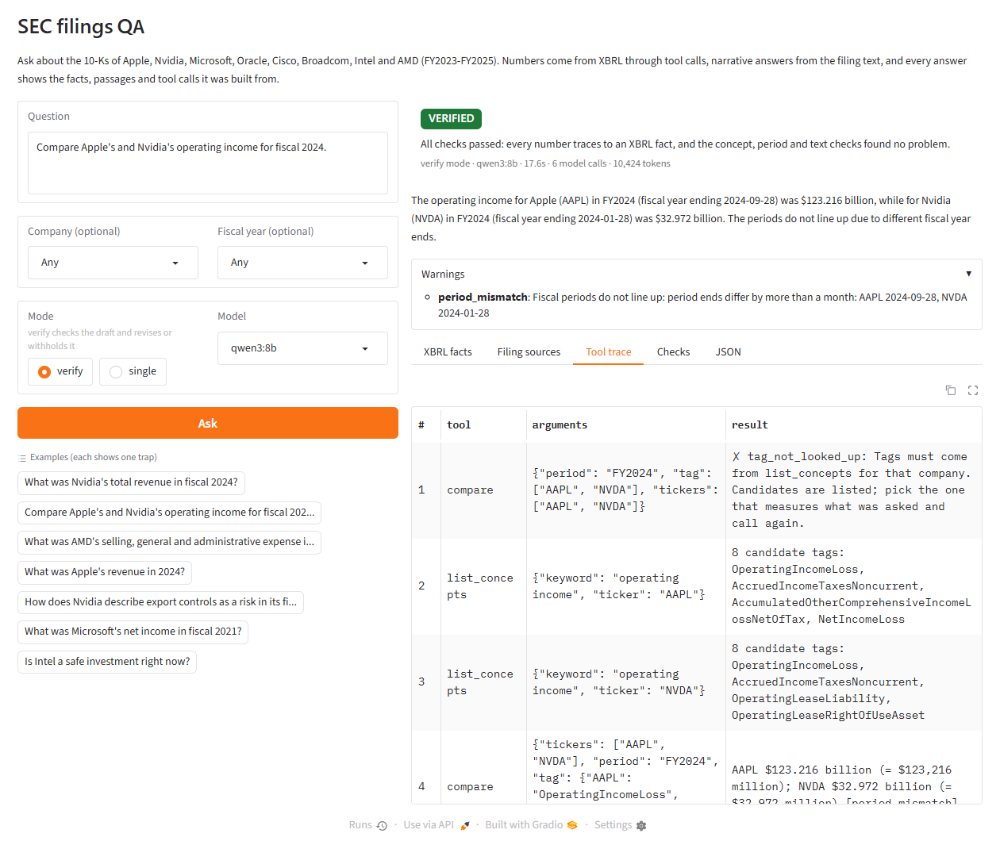
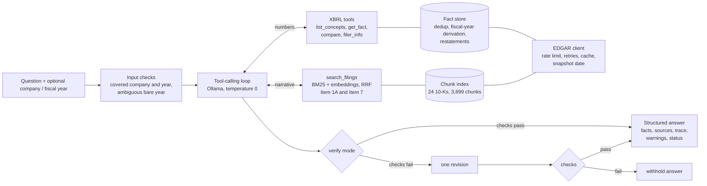
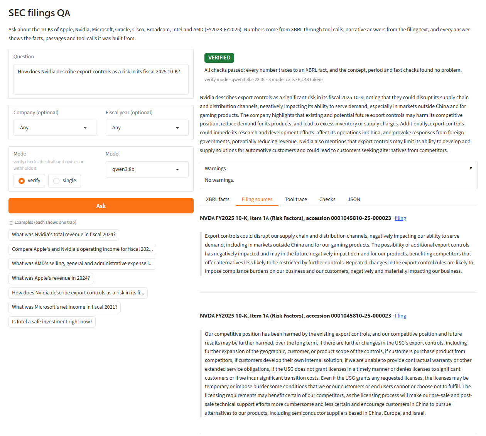

# sec-grounded-qa

[](https://github.com/RuyiYan7301/sec-grounded-qa/actions/workflows/ci.yml)


A question-answering system over SEC 10-K filings that you can audit. It answers
numeric questions with deterministic XBRL tools, answers narrative questions by retrieving
10-K text, and returns the sources, warnings and full tool trace behind every answer. It runs
locally on [Ollama](https://ollama.com).

It covers Apple, Nvidia, Microsoft, Oracle, Cisco, Broadcom, Intel and AMD, fiscal years 2023-2025.



## Why this is harder than a lookup

| Trap | Example | How the system handles it |
|---|---|---|
| **Tag selection** | Apple tags revenue `RevenueFromContractWithCustomerExcludingAssessedTax`; Nvidia uses `Revenues` | The model must look up each filer's own tags (`list_concepts`) before fetching a value. A guessed tag gets candidates back, not a number |
| **Fiscal calendars** | Nvidia's FY2024 ended 2024-01-28; Apple's ended 2024-09-28 | Fiscal year is derived from the period end date. `compare` flags mismatched periods, and a second check on the facts used in the answer flags them even when the model skipped `compare` |
| **Ambiguous years** | "Apple's revenue in 2024": fiscal or calendar? | Detected before the model runs, for filers whose year is not the calendar year |
| **Restatements** | AMD's FY2024 SG&A: $2,783M as first reported, $2,735M in the next 10-K | Every distinct value is kept with its filing. The answer uses the latest one and a warning names both |
| **Untrusted text** | 10-K passages are company-written | Passages are quoted as data, never as instructions. Figures are never taken from text, only from XBRL |

## What an answer contains

```
$ secqa ask "What was AMD's selling, general and administrative expense in fiscal 2024?" --trace

AMD's selling, general and administrative expense in fiscal 2024 was $2.735 billion, as reported
in accession number 0000002488-26-000018. This figure was restated to $2.783 billion in a later
filing (accession number 0000002488-25-000012).

Status: VERIFIED - All checks passed: every number traces to an XBRL fact, and the concept,
period and text checks found no problem.

Warnings:
  ! [restated] AMD SellingGeneralAndAdministrativeExpense FY2024 was reported as $2.783 billion
    (= $2,783 million) in 10-K 0000002488-25-000012 and as $2.735 billion (= $2,735 million)
    in the later 10-K 0000002488-26-000018.

XBRL facts used:
  - AMD SellingGeneralAndAdministrativeExpense FY2024: $2.735 billion (period ends 2024-12-28)
    10-K 0000002488-26-000018 filed 2026-02-04  https://www.sec.gov/Archives/edgar/data/2488/...
  - AMD SellingGeneralAndAdministrativeExpense FY2024: $2.783 billion [earlier reported value]
    10-K 0000002488-25-000012 filed 2025-02-05  https://www.sec.gov/Archives/edgar/data/2488/...

Tool calls:
  1. list_concepts({"ticker": "AMD", "keyword": "selling, general and administrative expense"})
     -> 8 candidate tags: SellingGeneralAndAdministrativeExpense, InterestExpense, ...
  2. get_fact({"ticker": "AMD", "tag": "SellingGeneralAndAdministrativeExpense", "period": "FY2024"})
     -> AMD SellingGeneralAndAdministrativeExpense FY2024 = $2.735 billion (ends 2024-12-28, ...)

verify mode, qwen3:8b, 12.1s, 4 model calls, 5,540 tokens
```

This real output also shows a limit of the design. Both numbers are correct and traceable,
but the model got the direction of the restatement backwards: $2.783B was the original figure,
not the later one. The `restated` warning comes from the filing data, not the model, so it gets
the direction right. The checks prove where every number came from. They do not prove that
the sentences around the numbers are right.

`--json` returns the same thing as a structured object (`status`, `facts`, `sources`,
`tool_calls`, `checks`, `warnings`), and the web demo shows each part in its own tab.

## Architecture



In **verify** mode the draft goes through five checks before it is returned. A draft that
fails gets one revision with the list of failures. If the revision still fails, the system
withholds the answer and says so. **single** mode runs the same checks and reports them, but
returns the draft as is.

| Check | Kind | Catches |
|---|---|---|
| numbers | deterministic | a figure that is not in any tool result (percentages: not a ratio or change of two tool figures) |
| re-query | deterministic | a fact that does not come back when fetched again by (ticker, tag, period) |
| period flags | deterministic | a `period_mismatch` or restatement the answer does not mention |
| concept | LLM judge | a real figure under the wrong concept, such as revenue presented as a cost |
| support | LLM judge | a narrative claim the retrieved passages do not make |

## Quick start

You need Python 3.10+, [Ollama](https://ollama.com), and about 6 GB of disk: the `qwen3:8b`
model is 5.2 GB, the embedding model 0.4 GB, and the SEC data 60 MB.

```bash
git clone https://github.com/RuyiYan7301/sec-grounded-qa.git
cd sec-grounded-qa
python -m venv .venv && source .venv/bin/activate      # Windows: .venv\Scripts\activate
pip install -e ".[demo]"

cp .env.example .env            # then set SEC_USER_AGENT="Your Name you@example.com" (SEC policy)
ollama pull qwen3:8b

secqa setup                     # downloads XBRL facts and 24 10-Ks, builds the index (~15 min on CPU), runs `secqa doctor`
secqa ask --example 2           # or: secqa ask "What was Nvidia's total revenue in fiscal 2024?"
secqa app                       # web demo at http://127.0.0.1:7860
```

`secqa doctor` checks each requirement on its own line (packages, data, Ollama, model) and
says how to fix whatever is missing. The data is pinned to filings made on or before
`SECQA_SNAPSHOT` (2026-10-16), so a download made later rebuilds the same fact store and the
same test set. Nothing depends on files that are not in the repository or produced by `secqa setup`.

| Command | What it does |
|---|---|
| `secqa ask "..." [--company NVDA] [--fy FY2024] [--mode verify\|single] [--json] [--trace]` | answer one question |
| `secqa examples` / `secqa ask --example N` | seven demo questions, each showing one trap |
| `secqa app` | Gradio demo: answer, status, warnings, then tabs for XBRL facts, filing sources, tool trace, checks and JSON |
| `secqa eval --mode verify --model qwen3:8b --tag mine` | run the 96-query test set (resumable: an interrupted run continues where it stopped) |
| `secqa report --tag t2` | results table from `results/test/` |
| `secqa gen-questions` / `secqa verify-gold` | rebuild the test set; check its gold values against the 10-K text |



## Evaluation

The test set has **96 held-out queries**. 81 are generated from the fact store with fixed
templates and a fixed seed, in 9 types: single-year figures, tag traps, restatements,
year-over-year changes, mismatched and aligned cross-company comparisons, bare years, years out
of range, and metrics a company does not report. The other 15 are hand-written narrative,
advice, forecast and clarification queries. All 95 gold figures were found in the 10-K text
(`secqa verify-gold`), and 20 of them were also read in context. The queries were frozen in git
before any model saw them. None of them overlaps the 28-query development set used while
building the system.

**Main result (run t2):** qwen3 at three sizes, temperature 0, scored by fixed rules.

| model | single: correct | verify: correct | single: numbers traceable | verify: numbers traceable |
|---|---|---|---|---|
| qwen3:4b | 79/96 | 80/96 | 92/96 | **96/96** |
| qwen3:8b | 78/96 | 76/96 | 92/96 | **96/96** |
| qwen3:14b | 77/96 | 67/96 | 93/96 | **96/96** |

- **Verification guarantees traceability; it does not raise accuracy.** Every verify-mode
  answer has numbers that all trace to an XBRL fact. Accuracy stays at 76-80/96 (79-83%), the
  same as single mode. On the development set, rerunning a configuration flipped at most 1 of
  24 answers, so differences of 1-2 queries are noise.
- **The same model is a poor judge of its own answers, and it fails differently at each size.**
  As a judge, 4B rejected every narrative answer (0/8 in verify mode against 5/8 in single
  mode), including near-verbatim quotes. 14B rejected 10 of its 11 correct year-over-year
  answers ("only one year of data"), which is why its verify score drops to 67.
- **14B never points out mismatched fiscal periods** (0/10 in both modes), where 4B and 8B get
  7-9/10. The fact-level `period_mismatch` warning was added after these results. Applied
  afterwards to the saved t2 answers, it flags 21 of the 24 answers that failed the mismatch
  rule (the other 3 contain no figures at all), with no false alarms on the other 516 answers.

**How this run came about.** The first test run (t1) showed the number check rejecting correct
drafts: sign words ("a loss of"), shown calculations, and digits inside EDGAR URLs. It was
fixed before t2. The fix changed only the checker, so single-mode answers were identical in
t1 and t2. A later post-hoc run (t3) fixed both judges and brought verify back to 78/79/77.
It is reported as an engineering follow-up, not as the result. The verify mode in this
repository is the t3 version; single mode has not changed since t1. The full tables, per-type
breakdown and every query's answer and trace are in [`docs/evaluation.md`](docs/evaluation.md)
and [`results/`](results/).

## Design decisions

- **Numbers come from XBRL, never from text.** Every figure is a structured fact with a
  period, a unit and an accession number, so it can be checked by machine. Taking figures from
  filing text would make "grounded" mean "appears somewhere in a passage". The number check
  enforces this: figures that appear only in passages do not count.
- **Narrative answers come from retrieval, with citations.** Risk factors and MD&A are not in
  XBRL. Search is hybrid because dense search alone ranked generic MD&A introductions above the
  passages that contained the query's key term.
- **Exact search in numpy, no vector database.** At 3,899 chunks, exact cosine search takes
  milliseconds, and an approximate index would only add a dependency.
- **The checks that matter most are deterministic.** The LLM judges are where the evaluation
  found systematic errors. The checks that never misfired are the deterministic ones: traceable
  numbers, re-query, and period and restatement flags.
- **Withhold rather than guess.** In verify mode, a draft that still fails after one revision
  is replaced by a fixed message. The rejected draft is never shown, because in testing a
  rejected draft contained text planted in a filing.
- **Local models.** Everything runs on one machine. Cost is reported in tokens, not dollars.

## Project layout

```
src/secqa/
  edgar.py        EDGAR client: User-Agent, rate limit, retries with backoff, cache, snapshot date
  facts.py        fact store: dedup, fiscal year from period end, restatements kept
  tools.py        list_concepts, get_fact, compare, filer_info, search_filings
  filings.py      10-K download, HTML to text, Item 1A / Item 7 splitting
  retrieval.py    chunking, BM25 + embeddings, reciprocal rank fusion
  agent.py        tool-calling loop, single / verify modes, all checks
  guards.py       input validation and deterministic warnings
  response.py     structured answer (facts, sources, tool calls, checks, warnings)
  cli.py, app.py  command line and Gradio demo
  evaluation/     test-set generation, gold checking, batch runs, reports
data/eval/        test set (96), development set (28), hand-written queries
results/          every evaluation run, with each answer, tool trace and score
tests/            unit and integration tests, offline (trimmed real EDGAR fixture, scripted model)
```

## Development

```bash
pip install -e ".[dev]"
pytest          # ~100 tests, offline, about 3 s
ruff check src tests
```

CI runs lint and tests on Python 3.10-3.12 (Linux) and 3.11 (Windows). Tests use a 0.5 MB
trimmed copy of real EDGAR data (`tests/fixtures/`) and a scripted stand-in for the model, so
they need neither network access nor Ollama. They cover the fact store, every tool's error
paths, the number checker, EDGAR retry and backoff, 10-K section splitting, retrieval, the
verify loop (revise, withhold, nudge a stalled model), the CLI and the web handlers. A
regression test rescores every saved run and checks that the reported numbers do not change.

## Limitations

- Eight companies and three fiscal years, 10-Ks only for text (10-Q facts are in the XBRL store).
- The LLM judges use the same model as the answerer, and the evaluation shows that this
  produces false rejections.
- The checks verify where numbers came from, not the claims made about them (see the example above).
- Scoring is rule-based (regular expressions). It is identical across runs but can be wrong on
  a single answer. Every answer is saved in `results/` for checking.
- Latency figures come from one desktop with shared load and are not a benchmark.

## License

MIT
