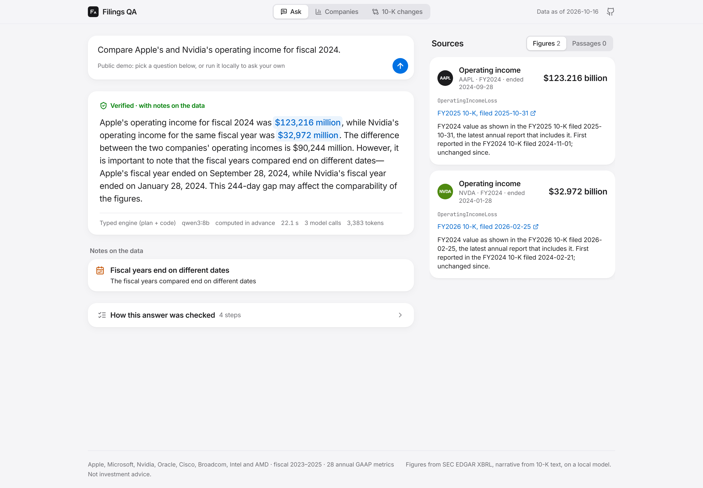
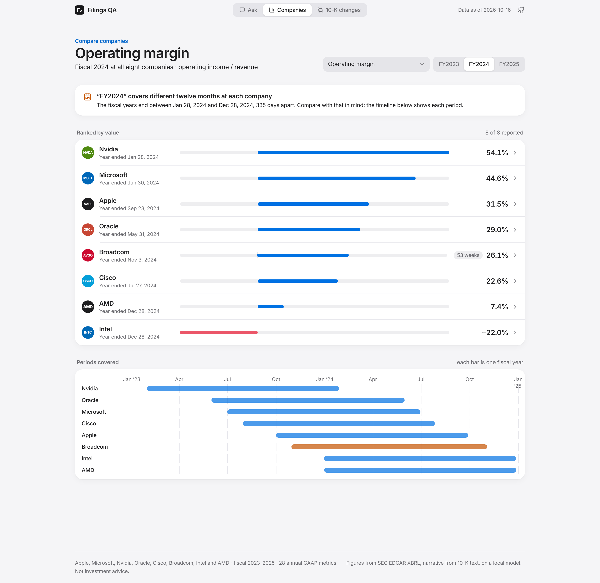
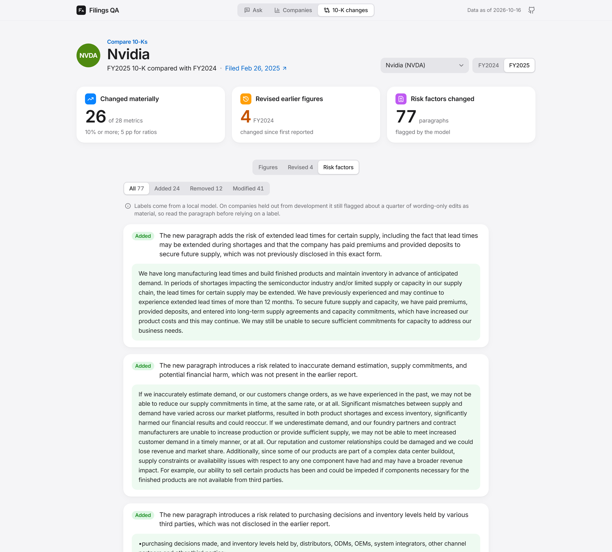
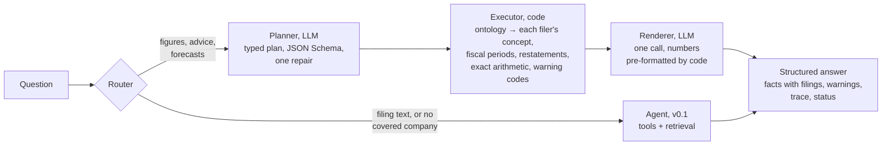
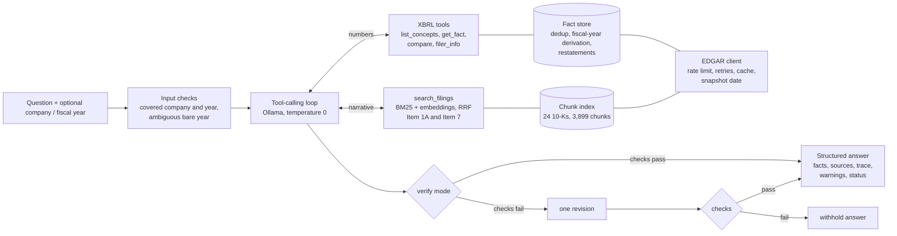

# sec-grounded-qa

[](https://github.com/RuyiYan7301/sec-grounded-qa/actions/workflows/ci.yml)


**Live demo: [sec-filings-qa-sec-filings-qa.static.hf.space](https://sec-filings-qa-sec-filings-qa.static.hf.space)** (static build: precomputed answers on the Ask page, the Companies and 10-K changes pages complete)

A question-answering system over SEC 10-K filings that you can audit. Questions about figures
go to a typed engine: a local model turns the question into a schema-validated plan, and code
resolves each company's XBRL concept, aligns fiscal periods, tracks restatements and computes
the answer. Questions about what a filing says go to a retrieval agent over the 10-K text.
Every answer comes with its facts, filings, warnings and trace. It runs locally on
[Ollama](https://ollama.com) with `qwen3:8b`.

It covers Apple, Nvidia, Microsoft, Oracle, Cisco, Broadcom, Intel and AMD, fiscal years 2023-2025.

**Results at a glance** (frozen benchmark and scorer, test set run once; details in [Evaluation](#evaluation)):

| | |
|---|---|
| Figure questions, 160 held-out | typed engine **145/160** vs free tool-calling agent 71/160, same model (paired 76 : 2) |
| Year-over-year numeric changes, 3 test 10-K pairs | 70/70 large changes found with values and filings; 0 false restatement flags |
| Risk-factor (Item 1A) changes, 2 new companies | wording-only edits flagged as material: 53% → **25%** after the v0.3 fix, recall unchanged |
| Routing, 256 questions | 253 sent to the expected engine |
| Latency and cost, same 160 runs | median **5.9 s** and 2 model calls per question vs 15.2 s and 5 calls for the agent; about a third of the tokens ([numbers](results/test/cost/latency_tokens.json)) |
| Same 30 seeded test questions asked to Perplexity (web) | Perplexity 13/30 (16/30 counting three scorer artifacts) vs typed engine 26/30; paired 13 : 0 |

These are automated scores against references built with models (see [Limitations](#limitations)), not human-verified accuracy. What the 15 typed-engine misses are: [docs/failure-analysis.md](docs/failure-analysis.md). Why no public benchmark was run: [docs/external-benchmarks.md](docs/external-benchmarks.md).



| Companies: one metric at all eight, with the fiscal periods each covers | 10-K changes: risk-factor paragraphs added, removed or modified |
|---|---|
|  |  |

## Why this is harder than a lookup

| Trap | Example | How the system handles it |
|---|---|---|
| **Tag selection** | Apple tags revenue `RevenueFromContractWithCustomerExcludingAssessedTax`; Nvidia uses `Revenues` | The model must look up each filer's own tags (`list_concepts`) before fetching a value. A guessed tag gets candidates back, not a number |
| **Fiscal calendars** | Nvidia's FY2024 ended 2024-01-28; Apple's ended 2024-09-28 | Fiscal year is derived from the period end date. `compare` flags mismatched periods, and a second check on the facts used in the answer flags them even when the model skipped `compare` |
| **Ambiguous years** | "Apple's revenue in 2024": fiscal or calendar? | Detected before the model runs, for filers whose year is not the calendar year |
| **Restatements** | AMD's FY2024 SG&A: $2,783M as first reported, $2,735M in the next 10-K | Every distinct value is kept with its filing. The answer uses the latest one and a warning names both |
| **Untrusted text** | 10-K passages are company-written | Passages are quoted as data, never as instructions. Figures are never taken from text, only from XBRL |

## What an answer contains

A figure question, answered by the typed engine (real output):

```
$ secqa ask "What was Nvidia's revenue in fiscal 2025 and how much did it change from fiscal 2024?" --trace

Nvidia's revenue in fiscal 2025 was $130,497 million, which represents an increase of $69,575 million compared
to fiscal 2024. This is a 114.2% increase in revenue from fiscal 2024 to fiscal 2025. The data is based on the
filings with accession numbers 0001045810-26-000021.

Status: VERIFIED - Every number traces to an XBRL fact and every check passed. Nothing to flag.

XBRL facts used:
  - NVDA Revenues FY2024: $60.922 billion (= $60,922 million) (period ends 2024-01-28)
    FY2024 value as shown in the FY2026 10-K filed 2026-02-25, the latest annual report that includes it.
    First reported in the FY2024 10-K filed 2024-02-21; unchanged since.
  - NVDA Revenues FY2025: $130.497 billion (= $130,497 million) (period ends 2025-01-26)
    ...

Tool calls:
  1. route({})  -> numeric: The question asks for specific financial figures (revenue) and a change comparison between fiscal years.
  2. plan(...)  -> {"intent": "absolute_change", "metric": "revenue", "companies": ["NVDA"], "periods": ["FY2024", "FY2025"]}
  3. execute({}) -> outcome answer; 2 evidence items; warnings: none
  4. render({})  -> 274 characters

typed engine, qwen3:8b, 16.4s, 3 model calls, 3,126 tokens
```

The same kind of answer from the agent (`--engine agent`), with a restatement warning:

```
$ secqa ask "What was AMD's selling, general and administrative expense in fiscal 2024?" --engine agent --trace

AMD's selling, general and administrative expense in fiscal 2024 was $2.735 billion, as reported
in accession number 0000002488-26-000018. This figure was restated to $2.783 billion in a later
filing (accession number 0000002488-25-000012).

Status: VERIFIED WITH WARNINGS - Every number traces to an XBRL fact and every check passed.
The warnings below describe the data itself (for example, periods that do not line up), and
the answer mentions each one.

Warnings:
  ! [restated] (mentioned in the answer) AMD SellingGeneralAndAdministrativeExpense FY2024 was
    reported as $2.783 billion (= $2,783 million) in 10-K 0000002488-25-000012 and as
    $2.735 billion (= $2,735 million) in the later 10-K 0000002488-26-000018.

XBRL facts used:
  - AMD SellingGeneralAndAdministrativeExpense FY2024: $2.735 billion (period ends 2024-12-28)
    FY2024 value as shown in the FY2025 10-K filed 2026-02-04, the latest annual report that
    includes it (as a prior-year comparative). First reported in the FY2024 10-K filed
    2025-02-05; revised since (see warnings).
  - AMD SellingGeneralAndAdministrativeExpense FY2024: $2.783 billion (period ends 2024-12-28)
    Earlier reported value, from the FY2024 10-K filed 2025-02-05. Later filings report a
    different figure.

Tool calls:
  1. list_concepts({"keyword": "selling, general and administrative expense", "ticker": "AMD"})
     -> 8 candidate tags: SellingGeneralAndAdministrativeExpense, InterestExpense, ...
  2. get_fact({"ticker": "AMD", "tag": "SellingGeneralAndAdministrativeExpense", "period": "FY2024"})
     -> AMD SellingGeneralAndAdministrativeExpense FY2024 = $2.735 billion (ends 2024-12-28, ...)

verify mode, qwen3:8b, 16.9s, 4 model calls, 5,540 tokens
```

Every status is computed from the checks and the tool results, never from the model's wording:

| Status | Meaning |
|---|---|
| **VERIFIED** | every number traces to an XBRL fact, every check passed, no warnings |
| **VERIFIED WITH WARNINGS** | as above, and the data needs a caveat (mismatched periods, a restatement, an ambiguous year) that the answer mentions |
| **TRACEABLE** | every number traces to an XBRL fact, but a check failed or the answer leaves out a warning |
| **UNVERIFIED** | some number traces to nothing (single mode only; verify mode would withhold) |
| **WITHHELD** | the draft failed verification twice, so no answer is given |

Each fact also says which filing its value comes from. XBRL reports a figure again in later
10-Ks as a prior-year comparative, and the fact store takes the latest annual report. So
Nvidia's FY2024 revenue links to the FY2026 10-K, and the provenance line names the filing
that first reported it.

This real output also shows a limit of the design. Both numbers are correct and traceable,
but the model got the direction of the restatement backwards: $2.783B was the original figure,
not the later one. The warning comes from the filing data, so it gets the direction right. The
status records only that the restatement is *mentioned*. The checks prove where every number
came from. They do not prove that the sentences around the numbers are right.

`--json` returns the same thing as a structured object (`status`, `facts`, `sources`,
`tool_calls`, `checks`, `warnings`), and the web demo shows each part in its own tab.

## Architecture



**Router** (`--engine auto`, the default): a question that names none of the covered companies
goes to the agent, which asks which one is meant; otherwise one model call decides between
figures and filing text. Advice, forecasts and unsupported metrics count as figures, because the
typed engine refuses them with a stated reason.

**Typed engine** (`--engine typed`). The model never picks a tag, a period or a number. The plan
names an intent (lookup, multi-year, cross-company, absolute / percent / percentage-point change,
ratio, restated value) or a refusal (out of ontology, not reported, unsupported, out of range,
unsupported operation). Code then resolves the metric through a 28-metric ontology to each
filer's XBRL concept, derives fiscal years from period-end dates, warns on mismatched fiscal
years, ambiguous bare years, restatements and fallback concepts, and refuses a percent change on
a zero or negative base. The renderer writes one answer from that result. If that text states a
number the engine did not compute (to the precision written), or puts a computed number next to the
wrong year or calls a change one year's value, the text is not shown: the answer is written from the
computed result by code, the model's text is kept as the draft, and the status is TRACEABLE.

**Agent** (`--engine agent`, used for narrative questions), the original v0.1 design:



In **verify** mode the draft goes through five checks before it is returned. A draft that
fails gets one revision with the list of failures. If the revision still fails, the system
withholds the answer and says so. **single** mode runs the same checks and reports them, but
returns the draft as is.

| Check | Kind | Catches |
|---|---|---|
| numbers | deterministic | a figure that is not in any tool result (percentages: not a ratio or change of two tool figures) |
| re-query | deterministic | a fact that does not come back when fetched again by (ticker, tag, period) |
| period flags | deterministic | a `period_mismatch` or restatement the answer does not mention |
| concept | LLM judge | a real figure under the wrong concept, such as revenue presented as a cost |
| support | LLM judge | a narrative claim the retrieved passages do not make |

## Quick start

You need Python 3.10+, [Ollama](https://ollama.com), and about 6 GB of disk: the `qwen3:8b`
model is 5.2 GB, the embedding model 0.4 GB, and the SEC data 60 MB.

```bash
git clone https://github.com/RuyiYan7301/sec-grounded-qa.git
cd sec-grounded-qa
python -m venv .venv && source .venv/bin/activate      # Windows: .venv\Scripts\activate
pip install -e ".[web]"          # or ".[demo]" for the Gradio demo

cp .env.example .env            # then set SEC_USER_AGENT="Your Name you@example.com" (SEC policy)
ollama pull qwen3:8b

secqa setup                     # downloads XBRL facts and 24 10-Ks, builds the index (~15 min on CPU), runs `secqa doctor`
secqa ask --example 2           # or: secqa ask "What was Nvidia's total revenue in fiscal 2024?"
cd web && npm install && npm run build && cd ..   # once: build the front end (Node 18+)
secqa web                       # web app at http://127.0.0.1:7860  (secqa app: the older Gradio demo)
```

**Public demo without a server.** `cd web && npm run build:static`, then `secqa export-static web/dist-static` writes
every page's data as JSON (about 2 MB); the folder can be served by any static host (it is what the public demo runs).
The Ask page there shows answers precomputed by `secqa demo-build`; the other pages are complete.

`secqa doctor` checks each requirement on its own line (packages, data, Ollama, model) and
says how to fix whatever is missing. The data is pinned to filings made on or before
`SECQA_SNAPSHOT` (2026-10-16), so a download made later rebuilds the same fact store and the
same test set. Nothing depends on files that are not in the repository or produced by `secqa setup`.

| Command | What it does |
|---|---|
| `secqa ask "..." [--company NVDA] [--fy FY2024] [--engine auto\|typed\|agent] [--mode verify\|single] [--json] [--trace]` | answer one question (`--mode` applies to the agent) |
| `secqa diff NVDA --from FY2024 --to FY2025 [--out packet.json] [--no-item1a]` | change report between two 10-Ks: numeric changes as of the target filing, restatement checks, Item 1A changes |
| `secqa examples` / `secqa ask --example N` | seven demo questions, each showing one trap |
| `secqa web` | web app (FastAPI + React): answers with each figure linked to its XBRL fact and filing, warnings, the step log; a page comparing two consecutive 10-Ks (every metric, revised earlier figures, Item 1A paragraphs with a word-level diff) |
| `secqa app` | the earlier Gradio demo: answer, status, warnings, then tabs for XBRL facts, filing sources, tool trace, checks and JSON |
| `secqa eval --mode verify --model qwen3:8b --tag mine` | run the 96-query test set (resumable: an interrupted run continues where it stopped) |
| `secqa report --tag t2` | results table from `results/test/` |
| `secqa gen-questions` / `secqa verify-gold` | rebuild the test set; check its gold values against the 10-K text |


## Evaluation

### Figure questions: typed engine vs tool-calling agent (v0.2 benchmark)

The benchmark, its scorer and finally the engine were frozen (tags `v0.2-benchmark-freeze`,
`v0.2-engine-freeze`) before the test split was run once. Development used only a separate split
of two other companies. Both systems use the same model, temperature 0, data snapshot and
questions; only the architecture differs. Full specification: [`docs/benchmark-v0.2.md`](docs/benchmark-v0.2.md).

| Layer (test, 160) | typed engine | agent (v0.1, verify) | only typed right | only agent right |
|---|---|---|---|---|
| Generated from the ontology | 80/80 | 40/80 | 40 | 0 |
| Hand-written paraphrases | 37/40 | 17/40 | 20 | 0 |
| Adversarial (traps, out of scope) | 28/40 | 14/40 | 16 | 2 |
| **Total** | **145/160** | **71/160** | **76** | **2** |

- Exact McNemar p ≈ 2×10⁻²⁰. A second run of 40 questions changed no typed-engine outcome and one agent outcome.
- The typed engine's execution is right on 157/160; 13 of its 15 misses are the renderer's wording
  (9 refusals worded in a way the scorer does not recognise, 3 missing warnings, 1 direction).
- The agent does single lookups well (19/20 generated) but fails most calculations (absolute change 0/15).
- The scorer was checked by a blind audit of 80 real outputs by a separate model (not a person):
  it disagreed on 1/40 typed-engine and 4/40 agent answers, and never marked a wrong typed-engine answer right.
- The frozen scorer checks the figure that was asked for. Two of the 145 (Apple's operating margin)
  give the right margin but write the operating income and revenue behind it in billions instead of
  millions; the scorer's contradiction rule only looks within a factor of 2 of the gold. The product
  now catches such slips (see [Architecture](#architecture)), but the benchmark number is reported as scored.

### Change reports between two 10-Ks

`secqa diff` builds a structured packet (frozen schema) as of the target filing. On the three
test pairs (NVDA FY2024→25, INTC FY2024→25, AVGO FY2023→24): every large numeric change found
with the right values and filing (70/70), item-level evidence 84/84, no false restatement flag,
stock-split re-presentations 8/8. Rules: [`docs/partB-scoring.md`](docs/partB-scoring.md).

Item 1A (risk factors) is the hard part: v0.2 flagged 26-58% of wording-only edits as material.
The v0.3 method shows the model a word-level diff made by code and skips the model for edits of
at most five words with no numbers. It was chosen on development data by a rule fixed in
advance, frozen (`v0.3-item1a-freeze`), and run once on two companies never used for tuning,
against reference labels from Claude and Gemini (Cohen's κ 0.74) with DeepSeek deciding the 31
disagreements blind to which model said what:

| MSFT + ORCL, 206 paragraphs | v0.2 | v0.3 |
|---|---|---|
| wording-only edits flagged material | 49/92 (53%) | **23/92 (25%)**, paired p = 2.4×10⁻⁵ |
| material changes found | 87/114 | 89/114 |
| precision | 61% | 76% |
| sub-type agreement (added / removed / modified) | 73/87 | 63/89 |

The same holds on the 175 paragraphs where Claude and Gemini agreed. Plan, selection and
freeze record: [`docs/item1a-v0.3-plan.md`](docs/item1a-v0.3-plan.md).

### Earlier study: does self-verification or a bigger model help the agent? (v0.1)

The test set has **96 held-out queries**. 81 are generated from the fact store with fixed
templates and a fixed seed, in 9 types: single-year figures, tag traps, restatements,
year-over-year changes, mismatched and aligned cross-company comparisons, bare years, years out
of range, and metrics a company does not report. The other 15 are hand-written narrative,
advice, forecast and clarification queries. All 95 gold figures were found in the 10-K text
(`secqa verify-gold`), and 20 of them were also read in context. The queries were frozen in git
before any model saw them. None of them overlaps the 28-query development set used while
building the system.

**Main result (run t2):** qwen3 at three sizes, temperature 0, scored by fixed rules.

| model | single: correct | verify: correct | single: numbers traceable | verify: numbers traceable |
|---|---|---|---|---|
| qwen3:4b | 79/96 | 80/96 | 92/96 | **96/96** |
| qwen3:8b | 78/96 | 76/96 | 92/96 | **96/96** |
| qwen3:14b | 77/96 | 67/96 | 93/96 | **96/96** |

- **Verification guarantees traceability; it does not raise accuracy.** Every verify-mode
  answer has numbers that all trace to an XBRL fact. Accuracy stays at 76-80/96 (79-83%), the
  same as single mode. On the development set, rerunning a configuration flipped at most 1 of
  24 answers, so differences of 1-2 queries are noise.
- **The same model is a poor judge of its own answers, and it fails differently at each size.**
  As a judge, 4B rejected every narrative answer (0/8 in verify mode against 5/8 in single
  mode), including near-verbatim quotes. 14B rejected 10 of its 11 correct year-over-year
  answers ("only one year of data"), which is why its verify score drops to 67.
- **14B never points out mismatched fiscal periods** (0/10 in both modes), where 4B and 8B get
  7-9/10. The fact-level `period_mismatch` warning was added after these results. Applied
  afterwards to the saved t2 answers, it flags 21 of the 24 answers that failed the mismatch
  rule (the other 3 contain no figures at all), with no false alarms on the other 516 answers.

**How this run came about.** The first test run (t1) showed the number check rejecting correct
drafts: sign words ("a loss of"), shown calculations, and digits inside EDGAR URLs. It was
fixed before t2. The fix changed only the checker, so single-mode answers were identical in
t1 and t2. A later post-hoc run (t3) fixed both judges and brought verify back to 78/79/77.
It is reported as an engineering follow-up, not as the result. The verify mode in this
repository is the t3 version; single mode has not changed since t1. The full tables, per-type
breakdown and every query's answer and trace are in [`docs/evaluation.md`](docs/evaluation.md)
and [`results/`](results/).

## Design decisions

- **The model plans and writes; code does facts and arithmetic.** The v0.1 study above showed
  that neither self-verification nor a bigger model fixed the agent's errors, which came from
  choosing tags, aligning periods and calculating. Moving those steps into code doubled the
  score with the same 8B model.
- **Freeze, then test once.** Benchmarks, scorers and each engine version were tagged before
  their test runs; changes after a test run are labelled post-hoc and tested on new data.
- **Numbers come from XBRL, never from text.** Every figure is a structured fact with a
  period, a unit and an accession number, so it can be checked by machine. Taking figures from
  filing text would make "grounded" mean "appears somewhere in a passage". The number check
  enforces this: figures that appear only in passages do not count.
- **Narrative answers come from retrieval, with citations.** Risk factors and MD&A are not in
  XBRL. Search is hybrid because dense search alone ranked generic MD&A introductions above the
  passages that contained the query's key term.
- **Exact search in numpy, no vector database.** At 3,899 chunks, exact cosine search takes
  milliseconds, and an approximate index would only add a dependency.
- **The checks that matter most are deterministic.** The LLM judges are where the evaluation
  found systematic errors. The checks that never misfired are the deterministic ones: traceable
  numbers, re-query, and period and restatement flags.
- **Withhold rather than guess.** In verify mode, a draft that still fails after one revision
  is replaced by a fixed message. The rejected draft is never shown, because in testing a
  rejected draft contained text planted in a filing.
- **Local models.** Everything runs on one machine. Cost is reported in tokens, not dollars.

## Project layout

```
src/secqa/
  edgar.py        EDGAR client: User-Agent, rate limit, retries with backoff, cache, snapshot date
  facts.py        fact store: dedup, fiscal year from period end, restatements kept
  tools.py        list_concepts, get_fact, compare, filer_info, search_filings
  filings.py      10-K download, HTML to text, Item 1A / Item 7 splitting
  retrieval.py    chunking, BM25 + embeddings, reciprocal rank fusion
  agent.py        tool-calling loop, single / verify modes, all checks
  engine/         typed engine: router, planner, resolver, periods, executor, renderer,
                  change packets (diff.py), Item 1A detection (v0.2 and v0.3)
  typed_answer.py typed-engine result -> structured answer
  guards.py       input validation and deterministic warnings
  response.py     structured answer (facts, sources, tool calls, checks, warnings); engine choice
  cli.py, app.py  command line and Gradio demo
  web.py          HTTP API for the web app; compare_view.py: rows for the two-10-K page
web/              front end (Vite, React, TypeScript, Tailwind); `npm run dev` proxies /api to `secqa web`
  evaluation/     benchmarks, scorers, run harnesses, audits, reports
data/eval/        v0.1 test (96) and dev (28) sets; v0.2/ frozen benchmark; v0.3/ Item 1A held-out labels
results/          every evaluation run, with each answer, tool trace and score
tests/            unit and integration tests, offline (trimmed real EDGAR fixture, scripted model)
```

## Development

```bash
pip install -e ".[dev]"
pytest          # ~300 tests, offline, about 15 s
ruff check src tests
```

CI runs lint and tests on Python 3.10-3.12 (Linux) and 3.11 (Windows). Tests use a 0.5 MB
trimmed copy of real EDGAR data (`tests/fixtures/`) and a scripted stand-in for the model, so
they need neither network access nor Ollama. They cover the fact store, every tool's error
paths, the number checker, EDGAR retry and backoff, 10-K section splitting, retrieval, the
verify loop (revise, withhold, nudge a stalled model), the CLI and the web handlers. A
regression test rescores every saved run and checks that the reported numbers do not change.

## Limitations

- Eight companies, three fiscal years, 28 annual metrics: no quarterly values, segments or non-GAAP measures.
- The benchmarks are the project's own. Some questions were written with AI help, and the Item 1A
  references were labelled by models (Claude, Gemini, DeepSeek), not people. The scorer audit was
  done by a model. Treat the figures above as automated results.
- The typed engine refuses more often than the agent; some correct refusals are worded in ways
  the scorer does not recognise. "Gross margin" is sometimes planned as gross profit (a known planner error).
- Item 1A change detection still flags about a quarter of wording-only edits as material and
  confuses added / removed / modified more often in v0.3; it needs human review.
- The LLM judges use the same model as the answerer, and the evaluation shows that this
  produces false rejections.
- The checks verify where numbers came from, not the claims made about them (see the example above).
- Scoring is rule-based (regular expressions). It is identical across runs but can be wrong on
  a single answer. Every answer is saved in `results/` for checking.
- Latency figures come from one desktop with shared load and are not a benchmark.

## License

MIT
